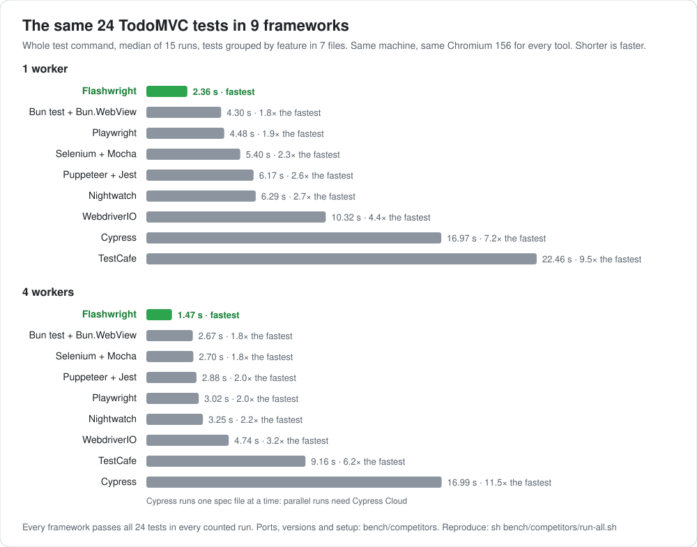

# Flashwright

**The fastest end-to-end testing framework.** Flashwright is a fork of Playwright 1.64.1 that spends less time running your tests. Same API, same test runner, same `npx playwright test`. Replace the package and keep your existing tests.

In the benchmark matrix below, complete test runs take one-quarter to one-half as long as stock Playwright. There are some behavior differences behind those numbers, including recycled browser contexts and shorter waits. They're documented [below](#differences-from-playwright), with options to turn them off.

[flashwright.dev](https://flashwright.dev)


<sub>Playwright's own TodoMVC example suite, run by both on the same machine. The recorded output of real runs, played back in real time ([MP4](docs/media/race.mp4)).</sub>

- The [framework comparison](#compared-to-other-frameworks) runs the same 24 TodoMVC tests in nine tools. Flashwright is 1.8× faster than the runner-up, 1.9–2× faster than Playwright, and 3–12× faster than WebdriverIO, TestCafe and Cypress in the grouped runs.
- The [Playwright benchmark matrix](#benchmarks) covers example suites, a sign-in app with a setup project, an admin page with 8,500 elements, failures, screenshots and visual comparisons. Flashwright is at least 2× faster in every measured scenario, with a reported average of 2.83×.
- Compatibility is checked against Playwright's own test suites. The [results and remaining differences](#compatibility) are below.
- For agents re-running a test after an edit, a [warm session](#warm-session) keeps the browser around. A single test can re-run in under 0.1 s instead of 0.6–0.7 s. Screenshots take about half the time, and the MCP server can return when the page settles.

## Install

Flashwright publishes three npm packages under aliases for Playwright's packages. For the test runner, replace `@playwright/test`. Your imports and commands stay the same:

```bash
npm i -D @playwright/test@npm:flashwright-test
npx playwright install chromium
npx playwright test
```

Flashwright needs Node.js 22.18 or newer. You can also run TypeScript configs and tests on Bun with `bunx --bun playwright test`. Stock Playwright 1.64.1 parses TypeScript as JavaScript there and fails at the first type annotation.

Projects that use the library without the test runner replace `playwright` the same way (`npm i playwright@npm:flashwright`), and `playwright-core` is `flashwright-core`. Browsers, configs, reporters, the trace viewer, codegen and the VS Code extension are Playwright's.

## Documentation

- [Performance](docs/performance.md): optimisations, defaults, opt-in settings and implementation details.
- [Quality-of-life features](docs/features.md): videos, diagnostics, snapshots, project servers and migration tools.
- [Configuration](docs/configuration.md): options, examples and limitations.
- [Agent workflows](docs/agents.md): reporters, JSON summaries, watch mode, warm sessions and MCP.
- [Videos and demos](docs/videos.md): recording, narration and voices.
- [Migration](docs/migration.md): behaviour differences, deprecated APIs, codemod and Bun.
- [Benchmarks](docs/benchmarks.md): methodology, reproduction steps and full results.

## Compared to other frameworks

<picture>
  <source media="(prefers-color-scheme: dark)" srcset="docs/media/competitors-dark.svg">
  
</picture>

The same 24 TodoMVC tests, ported to nine tools with the same actions, assertions and CSS selectors. Each tool drives Chromium 156 on the same machine, using its recommended waits and default test isolation. Numbers are median times for the complete test command.

Cypress runs one spec at a time without Cypress Cloud. Bun's experimental `Bun.WebView` needs a helper for waits. [Full results, versions and reproduction steps](docs/benchmarks.md#compared-to-other-frameworks).

## Benchmarks


Median times for complete test commands, from launch to exit, on the same 6-CPU Linux machine with Chromium's headless shell. The tests are unchanged, and the warm session is off, as in CI. The matrix covers Playwright's TodoMVC and SVGOMG examples, shop and admin apps, failures, screenshots and visual comparisons.

[Full results, methodology and reproduction steps](docs/benchmarks.md).

## How is it so fast?

Flashwright spends less time starting browsers, compiling the same JavaScript and waiting between checks:

- **Reuse the browser context.** Each worker keeps a context and gives each test a new tab, then resets storage, permissions, routes and the other state a test can change. Firefox and WebKit reuse the tab too. Use `isolation: 'strict'` for a new context per test.
- **React when the page changes.** Actions and assertions re-check on page changes instead of waiting through a 20–500 ms backoff. Assertions fail early when nothing can change the page before their timeout.
- **Skip animation-frame waits before input.** Pointer actions don't wait for elements to stop moving. Playwright's hit-target check still verifies that the element receives the input.
- **Start work early.** Workers and browsers start while the CLI reads the config, and the longest tests run first. Code caching, lazy loading and fewer browser round trips reduce startup and per-call overhead.
- **Do less work per locator and screenshot.** Locator queries avoid repeated style and accessible-name calculations. Screenshots use faster PNG encoding with the same pixels, and visual comparisons have fast paths for unchanged images.

See [all optimisations and how they work](docs/performance.md), including defaults, local workflows and optional settings. These choices have [observable differences from Playwright](#differences-from-playwright); the [configuration reference](docs/configuration.md) explains the options and tradeoffs.

## Speed options

Change the defaults per project, file or `describe` block. Options cover isolation, animation waits, resource blocking, worker sharing, page preloading and locator policy.

[Configuration reference and examples](docs/configuration.md#speed-options).

## For agents

A warm session can re-run one TodoMVC test in 72 ms instead of 652 ms. Agent mode prints failures and a summary, writes `test-results/summary.json`, and keeps passing-test output out of the way. Failed locators also suggest what the page actually has.

- `npx playwright test --watch` re-runs affected tests when you save a file.
- `npx playwright doctor` checks whether the project is ready to run; `--json` makes the results available to scripts.
- `playwright mcp --adaptive-settle` lets the MCP server return when the page settles instead of waiting a fixed 500 ms.

[Agent mode, watch mode and warm sessions](docs/agents.md).

## Warm session

Outside CI, the first test run starts a background session that keeps browsers ready for the next run. Test, config and environment changes are still picked up through fresh runner and worker processes.

The session stays for up to five minutes after the last run and holds about 0.4 GB after a one-test run or 1 GB after a four-worker suite. It's off by default on Windows, in CI and while debugging. Set `FLASHWRIGHT_SESSION=0` to disable it. [Details and benchmarks](docs/agents.md#warm-session).

## Videos of your tests


The same test, recorded twice. `--video` includes the test title, action captions and results; `--demo` keeps the page and narration. The preview is silent: watch [the test video with sound](docs/media/narrated-video.mp4) or [the demo with sound](docs/media/narrated-demo.mp4).

`npx playwright test --video` makes a narrated video of your tests with captions, a moving cursor and a camera that follows the action. Use `--demo` for a version without test names and results. Add `narrate()` calls to explain what's happening, or let Flashwright generate captions from the actions and assertions.

It needs `ffmpeg`. Recording adds waits for the page to paint, and captions include typed text, including passwords, so use test data you're happy to share. [Examples, voice setup and recording options](docs/videos.md).

## Quality-of-life features

Flashwright also supports a web server per project, `use` options on individual tests, pruning stale snapshots with `--prune-snapshots`, and accepting changed snapshots without a rerun with `npx playwright accept-snapshots`.

[All quality-of-life features](docs/features.md), with links to examples and limitations.

## Differences from Playwright

The API is compatible, but some defaults change what tests can observe:

- **Isolation:** contexts are reset and reused. Firefox and WebKit also reuse the tab, including its history. Set `isolation: 'strict'` or `FLASHWRIGHT_ISOLATION=strict` for a new context per test.
- **Moving elements:** pointer actions skip animation waits. Set `waitForAnimations: true` if your app ignores input while animating.
- **Assertion timeouts:** assertions can fail early on an idle page. Set `failFastWhenIdle: false` if the test changes the page from a Node.js timer while an assertion waits.
- **Test order:** the longest tests start first with multiple workers. Set `testOrder: 'file'` for Playwright's order.
- **Background processes:** the [warm session](#warm-session) keeps processes and browsers running after a local test command exits. Set `FLASHWRIGHT_SESSION=0` to turn it off.
- **Screenshots:** PNGs contain identical pixels but are 1.6–1.9× larger. `toHaveScreenshot()` baselines are unchanged.

[All behavior differences and migration tools](docs/migration.md), including reporter defaults, process lifecycle and deprecated APIs. Flashwright uses Playwright's own browser builds.

## Compatibility

Compatibility is checked with Playwright's own test suites against pristine Playwright 1.64.1 on the same machine. These are the reported results, using Chromium unless noted:

| Suite | Result |
| --- | --- |
| `tests/page` | 2616/2616 |
| `tests/page` on Firefox | 2590 passed; the other 4 pass when run alone |
| `tests/playwright-test` | same as pristine |
| `tests/library` | same as pristine, apart from two checks of internal bookkeeping that see the recycled context |
| `tests/mcp`, `tests/electron`, `tests/extension` | same as pristine |
| `tests/stress` | 1100/1100, in 20 s instead of 49 s |

Timing-sensitive tests can produce different results between runs in both versions.

## Building from source

```bash
npm ci
npm run build
npx playwright install chromium
```

- `packages/`, `tests/`, `docs/`, `utils/`: Playwright 1.64.1 with Flashwright's changes; [README.playwright.md](README.playwright.md) is Playwright's own README.
- `bench/`: the benchmark (`run.mjs` for one scenario, `matrix.mjs` for all), its app corpora, and the scripts that draw the chart and the video above (`bench/media/`).
- `utils/flashwright/pack.mjs`: builds the three npm packages from a clean build.

## License

Apache-2.0, like Playwright. Flashwright is an independent fork of [Playwright](https://github.com/microsoft/playwright) and is not affiliated with Microsoft.
