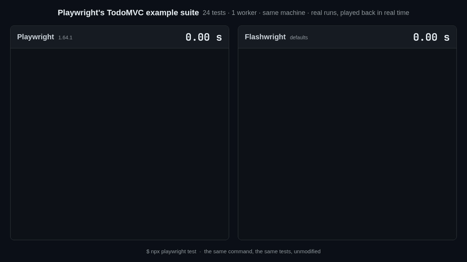
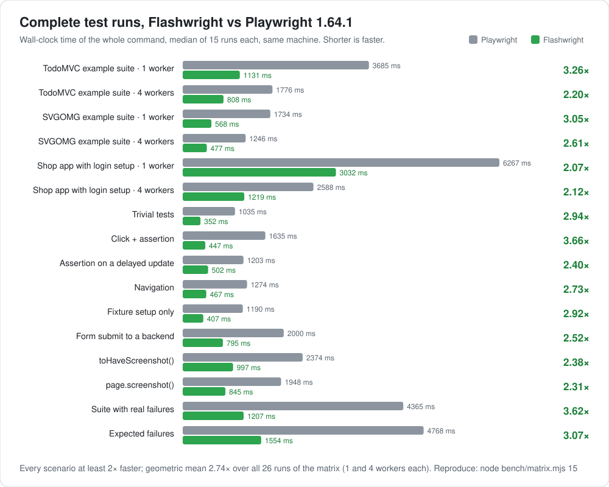

# Flashwright

**A faster Playwright.** Same API, same test runner, same `npx playwright test`: your existing Playwright suite runs unmodified and finishes 2–3.7× sooner.



<sub>Playwright's own TodoMVC example suite, run by both on the same machine. The recorded output of real runs, played back in real time ([MP4](docs/media/race.mp4)).</sub>

- **At least 2× faster on every scenario we measure**, 2.74× on average: real example suites, a sign-in app with a setup project, failing tests, screenshots, visual comparisons. [Benchmarks](#benchmarks).
- **A drop-in replacement.** Flashwright is a fork of Playwright 1.64.1 that changes only where time goes. Playwright's own test suites are its regression bar.
- **Made for agents that check their own work.** A single test re-runs in under 0.1 s instead of 0.6–0.7 s, because a [warm session](#warm-session) keeps the browser between runs; screenshots take half the time, and the MCP server can return as soon as the page settles.

## Install

Flashwright is published as three npm packages that stand in for Playwright's. Replace `@playwright/test` and keep everything else, imports and commands included:

```bash
npm i -D @playwright/test@npm:flashwright-test
npx playwright install chromium
npx playwright test
```

Projects that use the library without the test runner replace `playwright` the same way (`npm i playwright@npm:flashwright`), and `playwright-core` is `flashwright-core`. Browsers, configs, reporters, the trace viewer, codegen and the VS Code extension are Playwright's.

## Benchmarks



Each bar is the complete `test` command, from launch to exit, median of 15 alternating runs on the same machine (6 CPUs, Linux), with Chromium's headless shell. Flashwright runs with its defaults apart from the [warm session](#warm-session), which is off, as in CI; nothing in the test code changes. The TodoMVC and SVGOMG suites are Playwright's own examples, the shop is a small single-page app with a sign-in setup project and 40 ms API latency, and the other rows are 15-test files that each exercise one thing. Reproduce with `node bench/matrix.mjs 15`.

<details>
<summary>All 26 runs of the matrix, and how much of each run is the framework</summary>

| Scenario | Tests | Workers | Playwright | Flashwright | Speedup |
| --- | ---: | ---: | ---: | ---: | ---: |
| TodoMVC example suite | 24 | 1 | 3685 ms | 1131 ms | 3.26× |
| TodoMVC example suite | 24 | 4 | 1776 ms | 808 ms | 2.20× |
| SVGOMG example suite | 6 | 1 | 1734 ms | 568 ms | 3.05× |
| SVGOMG example suite | 6 | 4 | 1246 ms | 477 ms | 2.61× |
| Shop app (setup project, 40 ms API latency) | 18 | 1 | 6267 ms | 3032 ms | 2.07× |
| Shop app | 18 | 4 | 2588 ms | 1219 ms | 2.12× |
| Trivial tests | 15 | 1 | 1035 ms | 352 ms | 2.94× |
| Click + assertion | 15 | 1 | 1635 ms | 447 ms | 3.66× |
| Assertion on a delayed update | 15 | 1 | 1203 ms | 502 ms | 2.40× |
| Navigation | 15 | 1 | 1274 ms | 467 ms | 2.73× |
| Fixture setup only | 15 | 1 | 1190 ms | 407 ms | 2.92× |
| Form submit to a backend (20 ms API) | 15 | 1 | 2000 ms | 795 ms | 2.52× |
| `toHaveScreenshot()` against a baseline | 15 | 1 | 2374 ms | 997 ms | 2.38× |
| `page.screenshot()` to a file | 15 | 1 | 1948 ms | 845 ms | 2.31× |
| Suite with real failures (every third test) | 15 | 1 | 4365 ms | 1207 ms | 3.62× |
| Expected failures (250 ms timeout each) | 15 | 1 | 4768 ms | 1554 ms | 3.07× |
| A single test, as an agent re-runs it | 1 | 1 | 602 ms | 257 ms | 2.34× |
| A single TodoMVC test | 1 | 1 | 681 ms | 337 ms | 2.02× |

The one-file scenarios run in a single worker whatever the setting, so their 4-worker runs (2.24×–3.66×) match the ones above.

Part of some runs is the application itself: its delays and its server's response time, which no framework can remove. Without it, Flashwright spends 2.8×–4.2× less time than Playwright:

| Scenario | Workers | The application's waits | Playwright adds | Flashwright adds | |
| --- | ---: | ---: | ---: | ---: | ---: |
| Form submit to a backend | 1 | 15 × 20 ms | 1700 ms | 495 ms | 3.43× |
| Assertion on a delayed update | 1 | 15 × 8 ms | 1083 ms | 382 ms | 2.84× |
| Shop app | 1 | ~2.1 s of API time | 4153 ms | 979 ms | 4.24× |
| Shop app | 4 | ~1.15 s / ~0.85 s of API time | 1435 ms | 371 ms | 3.87× |

</details>

## Where the time goes

Flashwright keeps Playwright's observable behavior; [Differences from Playwright](#differences-from-playwright) lists what remains.

- **Warm browsers, fresh contexts.** Compiling the application's JavaScript in a new renderer dominates many suites. Flashwright keeps one browser context per worker and gives each test a brand-new tab in it, then resets everything a test can change: options, permissions, cookies, every visited origin's storage (local, session, IndexedDB, Cache Storage, service workers), caches, routes, init scripts, bindings, downloads and clock, and re-applies `storageState`. The previous test's pages are stopped before anything is cleared, so a late script cannot leak state into the next test. See `tests/page/recycle-isolation.spec.ts`.
- **Waits that react to the page.** Auto-waiting actions and assertions re-check as soon as the page changes instead of after a 20–500 ms backoff. An assertion that cannot pass any more, because nothing can change the page before its timeout, fails right away.
- **No frame waits before input.** Clicks, hovers, taps and drags don't wait for animation frames or for moving elements to stop. Playwright's hit-target check still makes sure the element receives the input.
- **Workers and browsers ready before they're needed.** Worker processes and their browsers start while the CLI is still reading the config, a spare stands by once tests fail, and an idle spare already holds the context its first test will ask for. The longest tests start first.
- **A faster start.** A V8 code cache for Playwright's own bundles, lazy loading of everything a run doesn't use, and less work per call: lazy stack formatting, fewer browser round trips per action, minified page scripts the browser compiles once.
- **Faster screenshots.** Speed-optimized PNG encoding for `page.screenshot()` (same pixels), and pixel comparison with fast paths for `toHaveScreenshot()`, whose baselines stay byte-identical to Playwright's.

## Speed options

Flashwright defaults to speed, and each project, file or `describe` block can turn off what it doesn't need, or turn Playwright's behavior back on:

```ts
// playwright.config.ts: Playwright's behavior, for a suite that relies on it
export default defineConfig({
  testOrder: 'file',          // run tests in Playwright's order
  use: {
    waitForAnimations: true,  // wait for elements to stop moving before input
    failFastWhenIdle: false,  // let failing assertions wait out their timeout
  },
});

// a file or describe block that needs less
test.use({
  instantAnimations: true,                     // CSS and Web Animations end within a frame
  blockResources: ['image', 'font', 'media'],  // never load these
});
```

| Option | Default | What it does |
| --- | --- | --- |
| `waitForAnimations` | `false` | `true` makes pointer actions wait for CSS and Web Animations that move the element, like Playwright, for apps that ignore input while they animate. Electron windows keep Playwright's wait. |
| `failFastWhenIdle` | `true` | An assertion that hasn't passed fails once nothing can change the page before its timeout: no timer due, no request, socket, navigation, animation or worker, and no other call on the page. A test that changes the page from a timer in its own code while an assertion waits sets `false` (8 of Playwright's 2610 page tests do). |
| `testOrder` | `'longest-first'` | With several workers, the tests that took longest last time start first. `'file'` keeps Playwright's order. |
| `workersPerProcess` | `1` | Workers that share one worker process (`--workers-per-process`). Each worker keeps its own browser and runs one test at a time; they share Node.js and the code it loaded. With 4 workers on TodoMVC, `2` takes a run from 1065 to 875 MB and `4` to 815 MB, at the same speed. Tests that run at the same time in one process share `process.env` (`TEST_WORKER_INDEX` holds one worker's index: use `testInfo.workerIndex`), global variables, and the process: a crash or `process.exit()` ends them all. |
| `instantAnimations` | `false` | The page's CSS transitions, CSS animations and Web Animations run 1000× faster, so fades and slides end at once (Chromium). On a page with a fading dialog: 2.3× faster than without. |
| `blockResources` | none | Requests for these types (`image`, `media`, `font`, `stylesheet`, `script`) fail before any route sees them. On a 24-image product page: 1.4× faster, 6.8× with `instantAnimations`. |
| `webSecurity` | `true` | `false` launches Chromium without the same-origin policy and mixed-content blocking, for a front end whose API sends no CORS headers in tests. |
| `preloadPages` | `false` | While a test runs, the next test's page loads in a second context, and that test's first `goto` returns at once. Until then the test sees a blank tab; any other call first, or another URL, gets a reset tab as without the option. Takes effect with one worker, or workers fewer than half the CPU cores. With one worker: TodoMVC 1.26×, a suite waiting on its API 1.40× faster. Not for tests that change the server from Node before their `goto` (the page loaded before that change) or watch the requests it receives (the next test's page loads meanwhile). |

Playwright's own options combine with these: `javaScriptEnabled: false`, `serviceWorkers: 'block'`, `bypassCSP`.

## For agents

- **Re-running one test** takes about 85 ms instead of 602 ms, in the [warm session](#warm-session) that the first run starts; that first run takes 257 ms. `playwright cli` commands start in ~45 ms instead of ~260 ms.
- **Screenshots** take about half the time, and `toHaveScreenshot()` returns immediately when nothing changed.
- **The MCP server** can answer as soon as the page has settled instead of after a fixed 500 ms: `playwright mcp --adaptive-settle` (or `timeouts.adaptiveSettle: true`). A click that saves through an API returns in 234 ms instead of 1014 ms.

### Warm session

Outside CI, the first `playwright test` in a project starts a session in the background. The session keeps the next run's runner process and workers started, and it keeps the browsers: a worker that exits hands its browser to the session instead of closing it, with the context reset as between two tests and with the renderer that has already compiled the application. The next run's first test starts as warm as the second test of a run.

| Run, 1.5 s after the previous one | Playwright | Flashwright | Flashwright, warm session |
| --- | ---: | ---: | ---: |
| One TodoMVC test | 675 ms | 249 ms | 85 ms (7.9×) |
| TodoMVC suite, 1 worker | 3677 ms | 1115 ms | 993 ms (3.7×) |
| TodoMVC suite, 4 workers | 1789 ms | 801 ms | 553 ms (3.2×) |
| SVGOMG suite, 1 worker | 1746 ms | 568 ms | 416 ms (4.2×) |
| SVGOMG suite, 4 workers | 1247 ms | 484 ms | 277 ms (4.5×) |
| Shop app, 1 worker | 6374 ms | 3022 ms | 2899 ms (2.2×) |
| Shop app, 4 workers | 2577 ms | 1219 ms | 1033 ms (2.5×) |

<sub>Medians of 15 (one test) or 9 alternating runs with a 1.5 s pause before each, like an agent that edits between runs; the session prepares the next run during that pause. Reproduce with `BENCH_PAUSE=1500 node bench/run.mjs todomvc 4 9 stock,fork,fork:FLASHWRIGHT_SESSION=1`.</sub>

Every run still gets new runner and worker processes, so changed tests, configs and environment variables are picked up as usual. A run whose environment, terminal or Flashwright install differs from the session's runs on its own, like without the session. A run returns once its results are reported; its workers hand their browsers over afterwards, unless a worker fixture of the project still has to tear down.

- **When it is on:** by default, except when the `CI` environment variable is set, when a debugger is attached, with `PWDEBUG`, `--ui` or `--debug`, and on Windows. A CI job usually runs its tests once, so a session would only hold memory there. `FLASHWRIGHT_SESSION=0` turns it off and `FLASHWRIGHT_SESSION=1` turns it on in CI.
- **What it holds:** one session per project directory, until 5 minutes after its last run (`FLASHWRIGHT_SESSION_TIMEOUT=<seconds>` changes that) or until Flashwright is reinstalled. While it waits, it keeps a runner, a worker for each kept browser and the browsers: about 0.4 GB after one-test runs and 1 GB after a 4-worker suite. Headed browsers are closed, not kept.

## Differences from Playwright

- **Recycled contexts.** Tests get a fresh context, in a browser context the worker keeps between tests (Chromium launched by the test runner). Contexts that record video, were paused or debugged, or visited a non-http origin are closed instead. `FLASHWRIGHT_ISOLATION=strict` creates a new context for every test, like Playwright. The browser behind recycled contexts runs a context's pages in one renderer process, so a crash or a busy script affects all of them.
- **Pointer actions on moving elements** are dispatched without waiting for the element to stop, unless `waitForAnimations` is set; the hit-target check still verifies them.
- **Assertions on an idle page** fail before their timeout unless `failFastWhenIdle: false`; the call log says so. The test runner adds a small script to its pages for this, which wraps the timer, animation frame and message functions. `browser.newContext()` outside the test runner is unaffected.
- **Test order**: with several workers, the longest tests start first unless `testOrder: 'file'`.
- **Process lifecycle**: worker processes and a headless browser may start before the config is read (unused ones close), and a finished worker's browser is killed rather than closed gracefully once no context is left open.
- **Warm session** (outside CI; `FLASHWRIGHT_SESSION=0` turns it off): after `playwright test` exits, a session process, the next run's runner and workers, and the run's browsers keep running, for up to 5 minutes after the last run. A test can see a browser process that an earlier run used, with its context reset as between two tests of one run.
- **Screenshot files** have identical pixels but are 1.6–1.9× larger PNGs. `toHaveScreenshot()` baselines are unchanged.
- **Temporary files**: worker counts, per-test durations, the context options each config used last (never storage state, credentials, headers, a proxy or certificates; readable only by you) and a V8 code cache live in the system temp directory. `PW_DISABLE_WORKER_STANDBY=1` and `FLASHWRIGHT_DISABLE_CODE_CACHE=1` turn off the first and the last.
- **Firefox and WebKit** keep Playwright's behavior, apart from the options above that apply to them, and **Electron** windows keep Playwright's waits for animations and assertion timeouts.

Flashwright runs Playwright's own browser builds. Playwright already launches them without what tests never see (sandbox, Safe Browsing, background networking, updates, extensions, sync, crash reporting); further switches such as `--disable-gpu` measured no faster, so there is no custom browser to install or trust.

## Compatibility

Playwright's own test suites are the bar, compared with pristine Playwright 1.64.1 on the same machine (Chromium unless noted):

| Suite | Result |
| --- | --- |
| `tests/page` | 2610/2610 |
| `tests/page` on Firefox | same as pristine (2578 passed) |
| `tests/playwright-test` | same as pristine |
| `tests/library` | same as pristine, apart from two checks of internal bookkeeping that see the recycled context |
| `tests/mcp`, `tests/electron`, `tests/extension` | same as pristine |
| `tests/stress` | 1100/1100, in 20 s instead of 49 s |

Timing-sensitive tests can differ from run to run in both.

## Building from source

```bash
npm ci
npm run build
npx playwright install chromium
```

- `packages/`, `tests/`, `docs/`, `utils/`: Playwright 1.64.1 with Flashwright's changes; [README.playwright.md](README.playwright.md) is Playwright's own README.
- `bench/`: the benchmark (`run.mjs` for one scenario, `matrix.mjs` for all), its app corpora, and the scripts that draw the chart and the video above (`bench/media/`).
- `utils/flashwright/pack.mjs`: builds the three npm packages from a clean build.

## License

Apache-2.0, like Playwright. Flashwright is an independent fork of [Playwright](https://github.com/microsoft/playwright) and is not affiliated with Microsoft.
