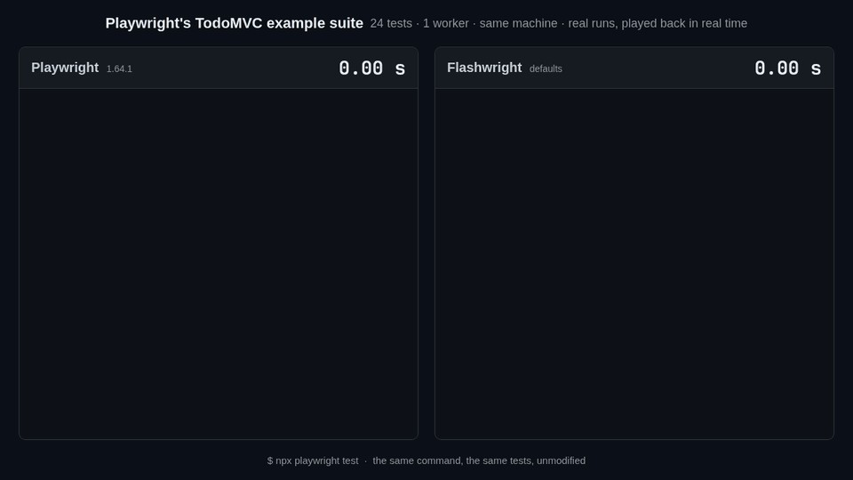
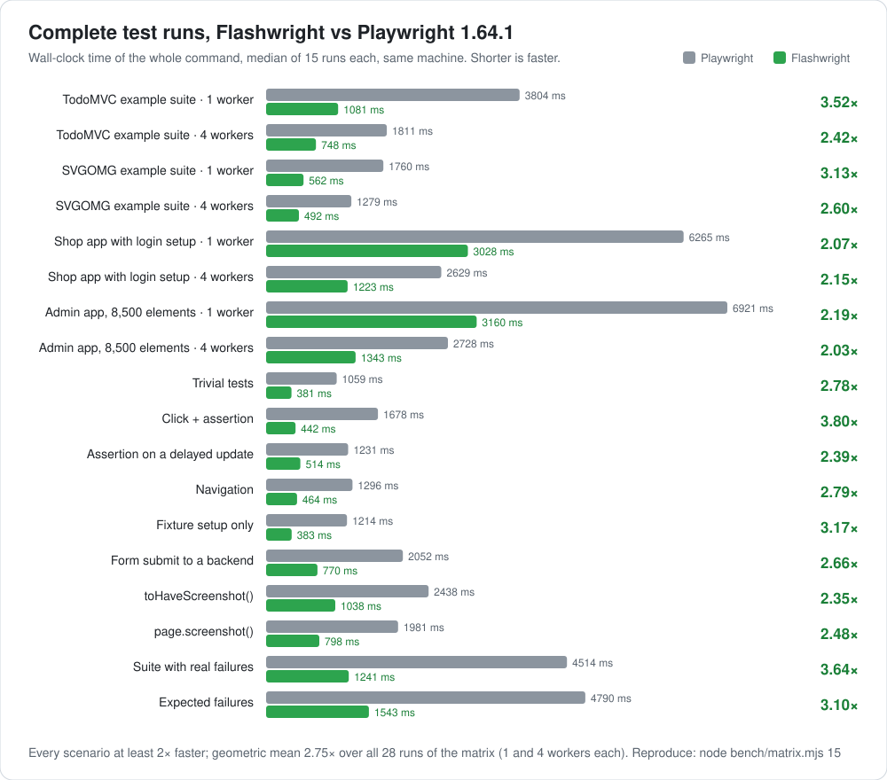

# Flashwright

**A faster Playwright.** Same API, same test runner, same `npx playwright test`: your existing Playwright suite runs unmodified and finishes 2–4× sooner. [flashwright.dev](https://flashwright.dev)



<sub>Playwright's own TodoMVC example suite, run by both on the same machine. The recorded output of real runs, played back in real time ([MP4](docs/media/race.mp4)).</sub>

- **At least 2× faster on every scenario we measure**, 2.86× on average: real example suites, a sign-in app with a setup project, an admin page of 8,500 elements, failing tests, screenshots, visual comparisons. [Benchmarks](#benchmarks).
- **A drop-in replacement.** Flashwright is a fork of Playwright 1.64.1 that changes only where time goes. Playwright's own test suites are its regression bar.
- **Made for agents that check their own work.** A single test re-runs in under 0.1 s instead of 0.6–0.7 s, because a [warm session](#warm-session) keeps the browser between runs; screenshots take half the time, and the MCP server can return as soon as the page settles.

## Install

Flashwright is published as three npm packages that stand in for Playwright's. Replace `@playwright/test` and keep everything else, imports and commands included:

```bash
npm i -D @playwright/test@npm:flashwright-test
npx playwright install chromium
npx playwright test
```

Projects that use the library without the test runner replace `playwright` the same way (`npm i playwright@npm:flashwright`), and `playwright-core` is `flashwright-core`. Browsers, configs, reporters, the trace viewer, codegen and the VS Code extension are Playwright's.

## Benchmarks



Each bar is the complete `test` command, from launch to exit, median of 15 alternating runs on the same machine (6 CPUs, Linux), with Chromium's headless shell. Flashwright runs with its defaults apart from the [warm session](#warm-session), which is off, as in CI; nothing in the test code changes. The TodoMVC and SVGOMG suites are Playwright's own examples, the shop is a small single-page app with a sign-in setup project and 40 ms API latency, the admin app is a page of 8,500 elements whose 19 tests find them by role, label and text, and the other rows are 15-test files that each exercise one thing. Reproduce with `node bench/matrix.mjs 15`.

<details>
<summary>All 28 runs of the matrix, and how much of each run is the framework</summary>

| Scenario | Tests | Workers | Playwright | Flashwright | Speedup |
| --- | ---: | ---: | ---: | ---: | ---: |
| TodoMVC example suite | 24 | 1 | 3670 ms | 1011 ms | 3.63× |
| TodoMVC example suite | 24 | 4 | 1812 ms | 734 ms | 2.47× |
| SVGOMG example suite | 6 | 1 | 1738 ms | 511 ms | 3.40× |
| SVGOMG example suite | 6 | 4 | 1253 ms | 498 ms | 2.52× |
| Shop app (setup project, 40 ms API latency) | 18 | 1 | 6297 ms | 2967 ms | 2.12× |
| Shop app | 18 | 4 | 2599 ms | 1194 ms | 2.18× |
| Admin app (8,500 elements, role, label and text locators) | 19 | 1 | 6805 ms | 3031 ms | 2.25× |
| Admin app | 19 | 4 | 2699 ms | 1320 ms | 2.04× |
| Trivial tests | 15 | 1 | 1024 ms | 341 ms | 3.00× |
| Click + assertion | 15 | 1 | 1611 ms | 402 ms | 4.01× |
| Assertion on a delayed update | 15 | 1 | 1191 ms | 473 ms | 2.52× |
| Navigation | 15 | 1 | 1266 ms | 415 ms | 3.05× |
| Fixture setup only | 15 | 1 | 1170 ms | 351 ms | 3.33× |
| Form submit to a backend (20 ms API) | 15 | 1 | 1983 ms | 729 ms | 2.72× |
| `toHaveScreenshot()` against a baseline | 15 | 1 | 2333 ms | 963 ms | 2.42× |
| `page.screenshot()` to a file | 15 | 1 | 1915 ms | 765 ms | 2.50× |
| Suite with real failures (every third test) | 15 | 1 | 4334 ms | 1154 ms | 3.76× |
| Expected failures (250 ms timeout each) | 15 | 1 | 4757 ms | 1498 ms | 3.18× |
| A single test, as an agent re-runs it | 1 | 1 | 593 ms | 184 ms | 3.22× |
| A single TodoMVC test | 1 | 1 | 666 ms | 240 ms | 2.77× |

The one-file scenarios run in a single worker whatever the setting, so their 4-worker runs (2.49×–4.16×) match the ones above.

Part of some runs is the application itself: its delays and its server's response time, which no framework can remove. Without it, Flashwright spends 3.0×–4.5× less time than Playwright:

| Scenario | Workers | The application's waits | Playwright adds | Flashwright adds | |
| --- | ---: | ---: | ---: | ---: | ---: |
| Form submit to a backend | 1 | 15 × 20 ms | 1683 ms | 429 ms | 3.92× |
| Assertion on a delayed update | 1 | 15 × 8 ms | 1071 ms | 353 ms | 3.03× |
| Shop app | 1 | ~2.1 s of API time | 4181 ms | 924 ms | 4.52× |
| Shop app | 4 | ~1.16 s / ~0.83 s of API time | 1435 ms | 361 ms | 3.98× |

</details>

## Where the time goes

Flashwright keeps Playwright's observable behavior; [Differences from Playwright](#differences-from-playwright) lists what remains.

- **Warm browsers, fresh contexts.** Compiling the application's JavaScript in a new renderer dominates many suites. Flashwright keeps one browser context per worker and gives each test a brand-new tab in it, then resets everything a test can change: options, permissions, cookies, every visited origin's storage (local, session, IndexedDB, Cache Storage, service workers), caches, routes, init scripts, bindings, downloads and clock, and re-applies `storageState`. The previous test's pages are stopped before anything is cleared, so a late script cannot leak state into the next test. See `tests/page/recycle-isolation.spec.ts`.
- **Waits that react to the page.** Auto-waiting actions and assertions re-check as soon as the page changes instead of after a 20–500 ms backoff. An assertion that cannot pass any more, because nothing can change the page before its timeout, fails right away.
- **No frame waits before input.** Clicks, hovers, taps and drags don't wait for animation frames or for moving elements to stop. Playwright's hit-target check still makes sure the element receives the input.
- **Workers and browsers ready before they're needed.** Worker processes and their browsers start while the CLI is still reading the config (the browser that all of the config's tests launched last time, with its launch options; it is used only if the config leaves the environment unchanged), a spare stands by once tests fail, and an idle spare already holds the context its first test will ask for. A worker whose tests use no browser closes the one it started: with 4 workers of API tests, the run peaks at 330 MB instead of 550. The longest tests start first.
- **A faster start.** A V8 code cache for Playwright's own bundles, lazy loading of everything a run doesn't use, and less work per call: lazy stack formatting, fewer browser round trips per action, minified page scripts the browser compiles once, and Chromium's DevTools protocol in the browser's own binary encoding (CBOR), so that it no longer converts every message to JSON and back: up to 9% faster on short tests, 4% on the TodoMVC suite with 4 workers (`FLASHWRIGHT_CDP_JSON=1` goes back to JSON).
- **Locators on large pages.** A named `getByRole()` first rules out, from their content, the elements whose accessible name cannot contain the one asked for, and computes only the others' names; role, label and text locators read each element's styles, role and labels once per query. On the admin app's 8,500 elements: a named `getByRole()` takes 14 ms instead of 41, `getByRole('row')` 2.3 ms instead of 7.8, `getByLabel()` 2.0 ms instead of 3.3.
- **Faster screenshots.** Speed-optimized PNG encoding for `page.screenshot()` (same pixels), and pixel comparison with fast paths for `toHaveScreenshot()`, whose baselines stay byte-identical to Playwright's. With `screenshot: 'only-on-failure'`, a recycled context's pages stand still when the test's context closes and are captured only if the test then fails, instead of every test taking a screenshot in case it does (TodoMVC: 1484 -> 1055 ms, screenshots off: 1051). A page waits at most 20 ms (the outcome normally comes within a millisecond), so what moves by itself, like a blinking caret or an animated image, moves no further than in the frame a screenshot waits for. A page that could still change otherwise (a call or request in flight, a WebSocket, a worker, a dialog, a loading image or font, playing media, styles for the `scripting` media feature) is captured right away, as before.

## Speed options

Flashwright defaults to speed, and each project, file or `describe` block can turn off what it doesn't need, or turn Playwright's behavior back on:

```ts
// playwright.config.ts: Playwright's behavior, for a suite that relies on it
export default defineConfig({
  testOrder: 'file',          // run tests in Playwright's order
  use: {
    waitForAnimations: true,  // wait for elements to stop moving before input
    failFastWhenIdle: false,  // let failing assertions wait out their timeout
  },
});

// a file or describe block that needs less
test.use({
  instantAnimations: true,                     // CSS and Web Animations end within a frame
  blockResources: ['image', 'font', 'media'],  // never load these
});
```

| Option | Default | What it does |
| --- | --- | --- |
| `waitForAnimations` | `false` | `true` makes pointer actions wait for CSS and Web Animations that move the element, like Playwright, for apps that ignore input while they animate. Electron windows keep Playwright's wait. |
| `failFastWhenIdle` | `true` | An assertion that hasn't passed fails once nothing can change the page before its timeout: no timer due, no request, socket, navigation, animation or worker, and no other call on the page. A test that changes the page from a timer in its own code while an assertion waits sets `false` (8 of Playwright's 2610 page tests do). |
| `isolation` | `'recycled'` | Each worker keeps one browser context and gives every test a new tab in it, reset between tests (on Firefox and WebKit, the same tab). `'strict'` gives every test a new context, like Playwright: slower, but nothing a reset could miss carries over. |
| `testOrder` | `'longest-first'` | With several workers, the tests that took longest last time start first. `'file'` keeps Playwright's order. |
| `workersPerProcess` | `1` | Workers that share one worker process (`--workers-per-process`). Each worker runs one test at a time; the workers of a process share Node.js, the code it loaded and the browser, where each worker's tests get contexts of their own. With 4 workers on TodoMVC, `2` takes a run from 795 to 590 MB and `4` to 493 MB, and makes it 1.08× and 1.12× faster. Each worker keeps its own `process.env`; tests that run at the same time in one process share global variables, the process and the browser: a crash, `process.exit()` or `browser.close()` ends them all. |
| `instantAnimations` | `false` | The page's CSS transitions, CSS animations and Web Animations run 1000× faster, so fades and slides end at once (Chromium). On a page with a fading dialog: 2.3× faster than without. |
| `blockResources` | none | Requests for these types (`image`, `media`, `font`, `stylesheet`, `script`) fail before any route sees them. On a 24-image product page: 1.4× faster, 6.8× with `instantAnimations`. |
| `locatorPolicy` | `'any'` | `'test-id'` lets only `getByTestId()` locators, and the methods that combine them, select elements; any other locator or selector fails right away. A test id is one attribute lookup, while role, label and text locators work out the role and text of the page's elements: on the 8,500 elements of the `inventory` benchmark, a named `getByRole()` takes 14 ms and a test id lookup 0.7 ms. |
| `webSecurity` | `true` | `false` launches Chromium without the same-origin policy and mixed-content blocking, for a front end whose API sends no CORS headers in tests. |
| `preloadPages` | `false` | While a test runs, the next test's page loads in a second context, and that test's first `goto` returns at once. Until then the test sees a blank tab; any other call first, or another URL, gets a reset tab as without the option. Takes effect with one worker, or workers fewer than half the CPU cores. With one worker: TodoMVC 1.26×, a suite waiting on its API 1.40× faster. Not for tests that change the server from Node before their `goto` (the page loaded before that change) or watch the requests it receives (the next test's page loads meanwhile). |

Playwright's own options combine with these: `javaScriptEnabled: false`, `serviceWorkers: 'block'`, `bypassCSP`.

## For agents

- **Re-running one test** takes about 75 ms instead of 673 ms, in the [warm session](#warm-session) that the first run starts; that first run takes 240 ms. `playwright cli` commands start in ~45 ms instead of ~260 ms.
- **Screenshots** take about half the time, and `toHaveScreenshot()` returns immediately when nothing changed.
- **Agent mode**: when Claude Code, Codex, Cursor, Gemini CLI, GitHub Copilot CLI or any tool that sets `AI_AGENT` runs `playwright test`, the output is the failures and nothing else, and the outcome is also written as JSON. See [agent mode](#agent-mode).
- **Failures say what the page has instead.** When an action or assertion waits for an element that never appears, the call log says which part of the locator stopped matching, whether a hidden element matches, and which elements are close, as locators to copy:
  ```
  - waiting for getByRole('button', { name: 'Logout' })
    - no element matched
      - similar buttons: getByRole('button', { name: 'Log out' })
  ```
  It covers role names, text, labels, placeholders, test ids, `nth()` and chains, and points at iframes when nothing is close.
- **`npx playwright doctor`** checks, without changing anything, what a run needs: Node, a single copy of Playwright, a config that loads, test files for each project, each project's browser and its system libraries, and a display for headed projects. It also says whether agent mode and the warm session are on. `--json` prints the checks for a script or an agent; it exits with 1 when something would stop a run.
- **The MCP server** can answer as soon as the page has settled instead of after a fixed 500 ms: `playwright mcp --adaptive-settle` (or `timeouts.adaptiveSettle: true`). A click that saves through an API returns in 234 ms instead of 1014 ms.

### Agent mode

When a coding agent runs the tests, the `list`, `line` and `dot` reporters give way to an `agent` reporter. It prints nothing for passing tests or their console output, prints each failure once (its last attempt, with the test's output), and ends with the counts and `npx playwright test --last-failed`. No colors, no rules of dashes, and the HTML report is never opened or served. 201 tests with one failure print 26 lines (888 bytes) instead of 425 (17.5 KB).

It also writes `test-results/summary.json`, with an `outcome` that tells apart failed tests (`failed`), errors outside tests such as a file that does not load (`error`), `no-tests`, `timedout` and `interrupted`; the counts; and for each failure its location, error, attachment paths and the command that reruns it. Exit codes stay the same.

`agentMode: true` or `false` in the config sets it, and `FLASHWRIGHT_AGENT_MODE=1` or `0` overrides both. A `--reporter` on the command line and file reporters (`html`, `json`, `junit`, `blob`) are kept. `reporter: 'agent'` works outside agent mode too, with `outputFile` to move the JSON.

### Watch mode

`npx playwright test --watch` runs, in the terminal, the tests of each test file you save and of the test files that import a file you save, with the command's filters. It is Playwright's terminal watch mode, which Playwright keeps behind an environment variable; `h` lists its other commands: run all, run the failures, repeat, change the project, file or title filter, show the browser.

A saved file's tests report 255 ms after the save instead of 1065 ms (4.2×; one test that opens a page, medians of 9): the changed files run right away instead of after listing every test, and while you read the results the next run's worker starts with its browser, and so does the process that loads test files, with babel already loaded.

### Warm session

Outside CI, the first `playwright test` in a project starts a session in the background. The session keeps the next run's runner process and workers started, and it keeps the browsers: a worker that exits hands its browser to the session instead of closing it, with the context reset as between two tests and with the renderer that has already compiled the application. The next run's first test starts as warm as the second test of a run.

| Run, 1.5 s after the previous one | Playwright | Flashwright | Flashwright, warm session |
| --- | ---: | ---: | ---: |
| One TodoMVC test | 673 ms | 240 ms | 76 ms (8.9×) |
| TodoMVC suite, 1 worker | 3648 ms | 1023 ms | 900 ms (4.1×) |
| TodoMVC suite, 4 workers | 1804 ms | 728 ms | 508 ms (3.6×) |
| SVGOMG suite, 1 worker | 1725 ms | 510 ms | 377 ms (4.6×) |
| SVGOMG suite, 4 workers | 1257 ms | 476 ms | 278 ms (4.5×) |
| Shop app, 1 worker | 6321 ms | 2969 ms | 2839 ms (2.2×) |
| Shop app, 4 workers | 2593 ms | 1194 ms | 1003 ms (2.6×) |

<sub>Medians of 15 (one test) or 9 alternating runs with a 1.5 s pause before each, like an agent that edits between runs; the session prepares the next run during that pause. Reproduce with `BENCH_PAUSE=1500 node bench/run.mjs todomvc 4 9 stock,fork,fork:FLASHWRIGHT_SESSION=1`.</sub>

Every run still gets new runner and worker processes, so changed tests, configs and environment variables are picked up as usual. A run whose environment, terminal or Flashwright install differs from the session's runs on its own, like without the session. A run returns once its results are reported; its workers hand their browsers over afterwards, unless a worker fixture of the project still has to tear down.

- **When it is on:** by default, except when the `CI` environment variable is set, when a debugger is attached, with `PWDEBUG`, `--ui` or `--debug`, and on Windows. A CI job usually runs its tests once, so a session would only hold memory there. `FLASHWRIGHT_SESSION=0` turns it off and `FLASHWRIGHT_SESSION=1` turns it on in CI.
- **What it holds:** one session per project directory, until 5 minutes after its last run (`FLASHWRIGHT_SESSION_TIMEOUT=<seconds>` changes that) or until Flashwright is reinstalled. While it waits, it keeps a runner, a worker for each kept browser and the browsers: about 0.4 GB after one-test runs and 1 GB after a 4-worker suite. Headed browsers are closed, not kept.

## Deprecated APIs

Playwright still ships about 95 methods its documentation discourages: the selector-based ones such as `page.click(selector)` and `page.fill(selector, value)`, element handles, `waitForNavigation`, `waitForTimeout`. Flashwright keeps them working and marks them `@deprecated` in its types, so that editors strike them through. `npx playwright codemod` shows, as a diff, how it rewrites the selector-based calls to locators (`page.click('#go')` becomes `page.locator('#go').click()`), `--write` applies it, and it lists with their location the calls to change by hand: element handles, `$eval`, `waitForNavigation`, `waitForTimeout`, `networkidle`. Locators are strict: where a selector matched several elements, the old call used the first one and the rewritten call fails; `--keep-first` adds `.first()` to keep the old behavior.

## Differences from Playwright

- **Recycled contexts.** Tests get a fresh context, in a browser context the worker keeps between tests (Chromium launched by the test runner). Tests that record video get a recycled context too, whose tab starts recording when the test gets it (TodoMVC with `video: 'retain-on-failure'`: 2850 -> 1312 ms); with video on some attempts only, such as `on-first-retry`, those attempts get a new context, as they always do on Firefox and WebKit. Contexts that were paused or debugged, or visited a non-http origin are closed instead. `isolation: 'strict'` (or `FLASHWRIGHT_ISOLATION=strict`) creates a new context for every test, like Playwright. The browser behind recycled contexts runs a context's pages in one renderer process, so a crash or a busy script affects all of them. Firefox and WebKit cannot clear an origin's storage without navigating, and opening a page there costs most of a short test (about 90 ms on Firefox): their tests reuse one context and its tab, which goes back to a blank page between tests with the same things reset, apart from the tab's history, which keeps the earlier tests' pages (`page.goBack()` at the start of a test can go to one of them). TodoMVC on Firefox: 6520 -> 3868 ms (1.69×). `isolation: 'strict'` gives them a new context per test.
- **Pointer actions on moving elements** are dispatched without waiting for the element to stop, unless `waitForAnimations` is set; the hit-target check still verifies them.
- **Assertions on an idle page** fail before their timeout unless `failFastWhenIdle: false`; the call log says so. The test runner adds a small script to its pages for this, which wraps the timer, animation frame and message functions. `browser.newContext()` outside the test runner is unaffected.
- **Test order**: with several workers, the longest tests start first unless `testOrder: 'file'`.
- **Process lifecycle**: worker processes and a headless browser may start before the config is read (unused ones close), and a finished worker's browser is killed rather than closed gracefully once no context is left open.
- **Warm session** (outside CI; `FLASHWRIGHT_SESSION=0` turns it off): after `playwright test` exits, a session process, the next run's runner and workers, and the run's browsers keep running, for up to 5 minutes after the last run. A test can see a browser process that an earlier run used, with its context reset as between two tests of one run.
- **Agent mode**: under a coding agent, the default terminal reporter is the `agent` one (see [agent mode](#agent-mode)); `agentMode: false` gives Playwright's.
- **Call logs** of an action or assertion whose element never appeared end with what the page has instead; finding it takes at most 500 ms, after the call has failed.
- **File watching** (`--watch` and UI mode) reacts 100 ms after the last change to a file instead of 250 ms.
- **Types**: the methods the documentation discourages are marked `@deprecated`, so editors strike them through; they work as before.
- **Screenshot files** have identical pixels but are 1.6–1.9× larger PNGs. `toHaveScreenshot()` baselines are unchanged.
- **Temporary files**: worker counts, per-test durations, the context options and the headless browser launch options each config used last (never storage state, credentials, headers, a proxy, certificates, environment variables, browser preferences or arguments with values other than a few harmless ones; readable only by you) and a V8 code cache live in the system temp directory. `PW_DISABLE_WORKER_STANDBY=1` and `FLASHWRIGHT_DISABLE_CODE_CACHE=1` turn off the first and the last.
- **Firefox and WebKit** keep Playwright's behavior, apart from reusing one tab per worker (see recycled contexts above) and the options above that apply to them, and **Electron** windows keep Playwright's waits for animations and assertion timeouts.

Flashwright runs Playwright's own browser builds. Playwright already launches them without what tests never see (sandbox, Safe Browsing, background networking, updates, extensions, sync, crash reporting); further switches such as `--disable-gpu` measured no faster, so there is no custom browser to install or trust.

## Compatibility

Playwright's own test suites are the bar, compared with pristine Playwright 1.64.1 on the same machine (Chromium unless noted):

| Suite | Result |
| --- | --- |
| `tests/page` | 2616/2616 |
| `tests/page` on Firefox | 2590 passed; the other 4 pass when run alone |
| `tests/playwright-test` | same as pristine |
| `tests/library` | same as pristine, apart from two checks of internal bookkeeping that see the recycled context |
| `tests/mcp`, `tests/electron`, `tests/extension` | same as pristine |
| `tests/stress` | 1100/1100, in 20 s instead of 49 s |

Timing-sensitive tests can differ from run to run in both.

## Building from source

```bash
npm ci
npm run build
npx playwright install chromium
```

- `packages/`, `tests/`, `docs/`, `utils/`: Playwright 1.64.1 with Flashwright's changes; [README.playwright.md](README.playwright.md) is Playwright's own README.
- `bench/`: the benchmark (`run.mjs` for one scenario, `matrix.mjs` for all), its app corpora, and the scripts that draw the chart and the video above (`bench/media/`).
- `utils/flashwright/pack.mjs`: builds the three npm packages from a clean build.

## License

Apache-2.0, like Playwright. Flashwright is an independent fork of [Playwright](https://github.com/microsoft/playwright) and is not affiliated with Microsoft.
