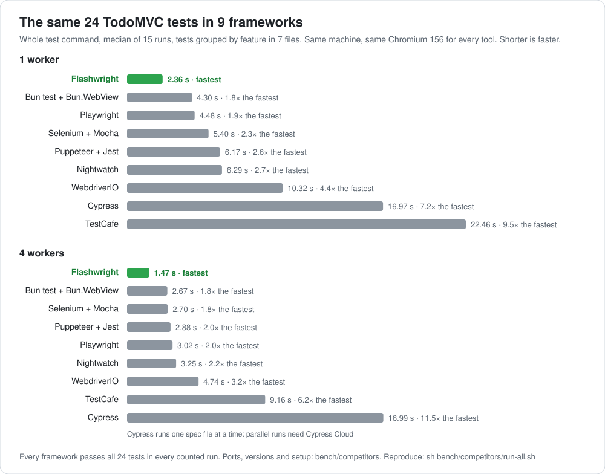
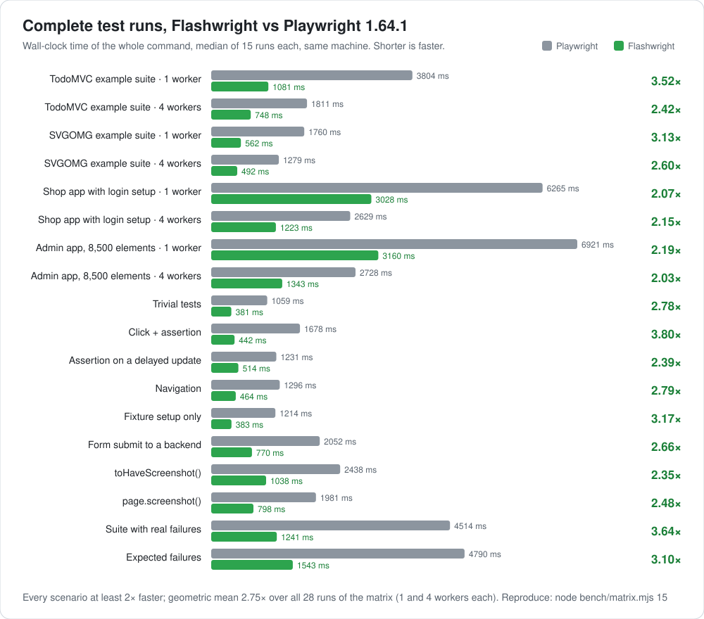

# Benchmarks

[Back to the README](../README.md)

## How many runs?

| Benchmark | Measured runs | Reported value |
| --- | --- | --- |
| Playwright comparison matrix | 15 per implementation, scenario and worker setting, with the order alternating | Median time from command launch to exit |
| Other frameworks | 15 attempted per tool, file layout and worker setting, with the starting tool rotated | Median of passing runs; failed runs are excluded |
| Warm session, single test | 15 per implementation or session variant | Median complete-command time |
| Warm session, suites | 9 per implementation or session variant | Median complete-command time |

Warm-session runs pause for 1.5 seconds before each command; the pause is not timed.

The main matrix has the warm session off, as in CI. [Warm-session results and reproduction](agents.md#warm-session) are documented separately. These counts describe the published results, rather than the scripts' default iteration counts.

## Compared to other frameworks

<picture>
  <source media="(prefers-color-scheme: dark)" srcset="media/competitors-dark.svg">
  
</picture>

Playwright's TodoMVC example suite, ported to each tool from one shared description of its 24 tests, so every tool runs the same actions and assertions with the same CSS selectors. Every tool drives the same Chromium 156 on the same machine with its own recommended waits (no fixed sleeps) and its default isolation between tests, and a run counts only when all 24 tests pass. Each number is the median time for the whole test command.

File layout matters too. Cypress bundles each spec, and WebdriverIO, Selenium and Nightwatch start a browser session per file. That adds up when every test has its own file, which is how Playwright's example is laid out:

| Tool | Grouped, 1 worker | Grouped, 4 workers | One test per file, 1 worker | One test per file, 4 workers |
| --- | ---: | ---: | ---: | ---: |
| **Flashwright** | **2.36 s** | **1.47 s** | **2.36 s** | **1.42 s** |
| Bun test + Bun.WebView | 4.30 s | 2.67 s | 4.31 s | 3.86 s |
| Playwright | 4.48 s | 3.02 s | 4.52 s | 2.87 s |
| Selenium + Mocha | 5.40 s | 2.70 s | 10.11 s | 4.69 s |
| Puppeteer + Jest | 6.17 s | 2.88 s | 6.02 s | 2.69 s |
| Nightwatch | 6.29 s | 3.25 s | 11.25 s | 5.29 s |
| WebdriverIO | 10.32 s | 4.74 s | 22.96 s | 8.91 s |
| TestCafe | 22.46 s | 9.16 s | 22.45 s | 9.19 s |
| Cypress | 16.97 s | 16.99 s¹ | 37.77 s | 37.90 s¹ |

¹ Cypress runs one spec file at a time: parallel runs need Cypress Cloud. Versions: Flashwright 1.64.1-flashwright.11, Playwright 1.64.1, Cypress 16.2.1, WebdriverIO 10.1.0, selenium-webdriver 4.52.0, Puppeteer 25.16.0, TestCafe 3.7.7, Nightwatch 3.16.0, Bun 1.4.4. `Bun.WebView` is an experimental browser API without assertions or text locators; its port waits with a small helper. Setup, every port and how to reproduce: [bench/competitors](../bench/competitors). Found a faster setting for a tool, or a port its users wouldn't write that way? Issues and pull requests are welcome.

## Compared to Playwright

Each bar shows the median time for the complete `test` command, from launch to exit, on the same machine (6 CPUs, Linux) with Chromium's headless shell. Flashwright runs with its defaults apart from the [warm session](agents.md#warm-session), which is off, as in CI; nothing in the test code changes. The TodoMVC and SVGOMG suites are Playwright's own examples, the shop is a small single-page app with a sign-in setup project and 40 ms API latency, the admin app is a page of 8,500 elements whose 19 tests find them by role, label and text, and the other rows are 15-test files that each exercise one thing. Reproduce with `node bench/matrix.mjs 15`.

### Full results

| Scenario | Tests | Workers | Playwright | Flashwright | Speedup |
| --- | ---: | ---: | ---: | ---: | ---: |
| TodoMVC example suite | 24 | 1 | 3617 ms | 968 ms | 3.74× |
| TodoMVC example suite | 24 | 4 | 1767 ms | 721 ms | 2.45× |
| SVGOMG example suite | 6 | 1 | 1687 ms | 523 ms | 3.23× |
| SVGOMG example suite | 6 | 4 | 1242 ms | 463 ms | 2.68× |
| Shop app (setup project, 40 ms API latency) | 18 | 1 | 6429 ms | 2950 ms | 2.18× |
| Shop app | 18 | 4 | 2558 ms | 1189 ms | 2.15× |
| Admin app (8,500 elements, role, label and text locators) | 19 | 1 | 6745 ms | 3018 ms | 2.23× |
| Admin app | 19 | 4 | 2639 ms | 1293 ms | 2.04× |
| Trivial tests | 15 | 1 | 975 ms | 351 ms | 2.78× |
| Click + assertion | 15 | 1 | 1582 ms | 386 ms | 4.10× |
| Assertion on a delayed update | 15 | 1 | 1156 ms | 474 ms | 2.44× |
| Navigation | 15 | 1 | 1213 ms | 419 ms | 2.89× |
| Fixture setup only | 15 | 1 | 1138 ms | 355 ms | 3.21× |
| Form submit to a backend (20 ms API) | 15 | 1 | 1910 ms | 715 ms | 2.67× |
| `toHaveScreenshot()` against a baseline | 15 | 1 | 2297 ms | 916 ms | 2.51× |
| `page.screenshot()` to a file | 15 | 1 | 1867 ms | 752 ms | 2.48× |
| Suite with real failures (every third test) | 15 | 1 | 4266 ms | 1128 ms | 3.78× |
| Expected failures (250 ms timeout each) | 15 | 1 | 4735 ms | 1500 ms | 3.16× |
| A single test, as an agent re-runs it | 1 | 1 | 577 ms | 187 ms | 3.09× |
| A single TodoMVC test | 1 | 1 | 651 ms | 242 ms | 2.69× |

The one-file scenarios run in a single worker whatever the setting, so their 4-worker runs (2.41×–4.10×) match the ones above.

Some of that time belongs to the app: explicit delays and server responses still take as long as they take. Subtract those waits, and Flashwright's remaining overhead is 2.9×–4.8× lower than Playwright's:

| Scenario | Workers | The application's waits | Playwright adds | Flashwright adds | |
| --- | ---: | ---: | ---: | ---: | ---: |
| Form submit to a backend | 1 | 15 × 20 ms | 1610 ms | 415 ms | 3.88× |
| Assertion on a delayed update | 1 | 15 × 8 ms | 1036 ms | 354 ms | 2.93× |
| Shop app | 1 | ~2.1 s of API time | 4312 ms | 907 ms | 4.75× |
| Shop app | 4 | ~1.19 s / ~0.83 s of API time | 1372 ms | 361 ms | 3.80× |
